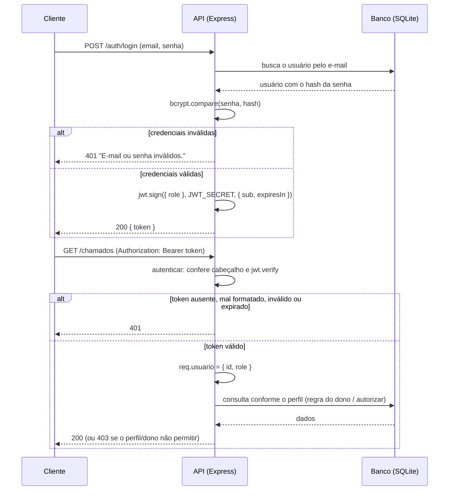

# API Chamados de Suporte — Projeto API Segura

**Grupo:** [José André], [Victor Gustavo dos Santos], [Vinicius Coelho] · 3º AI · ETECAMP

## 1. Sobre o projeto

API REST em Node.js para o registro e o acompanhamento de chamados de suporte (por exemplo, problemas com equipamentos e rede da escola). Usuários comuns (perfil `USER`) abrem e acompanham apenas os próprios chamados; administradores (perfil `ADMIN`) veem todos os chamados, alteram o status e gerenciam os perfis dos usuários. O recurso principal é o **Chamado**, que pertence a um usuário (relação 1:N com `User`).

**Tecnologias:** Node.js, Express 5, Prisma ORM 7, SQLite, `jsonwebtoken` (JWT) e `bcryptjs` (hash de senhas).

## 2. Como rodar

Requisito: Node.js 22 (recomendado). Em versões mais antigas, o `better-sqlite3` pode não ter binário pronto e exigir compilação.

```bash
npm install
copy .env.example .env        # Linux/Mac: cp .env.example .env
# abra o .env e troque o JWT_SECRET por uma chave longa e aleatória
npx prisma migrate dev --name init
npx prisma generate
npx prisma db seed
npm run dev
```

A API sobe em `http://localhost:3000`. Para voltar o banco ao estado inicial 

```bash
npx prisma migrate reset --force
npx prisma generate
npx prisma db seed
```

Usuários de teste (senha de todos: `Senha@123`):

| E-mail | Perfil |
|---|---|
| admin@suporte.com | ADMIN |
| ana@suporte.com | USER |
| bruno@suporte.com | USER |

## 3. Mapa de rotas

| Método | Rota | Acesso | Proteção |
|---|---|---|---|
| GET | / | Pública | — |
| POST | /auth/register | Pública | Validação dos campos; senha com hash bcrypt |
| POST | /auth/login | Pública | Mensagem de erro genérica; devolve o JWT |
| GET | /auth/me | Logado | `autenticar` |
| GET | /chamados | Logado | `autenticar`; USER vê os seus, ADMIN vê todos |
| POST | /chamados | Logado | `autenticar`; dono = id do token |
| PUT | /chamados/:id | Dono ou ADMIN | `autenticar` + regra do dono (404 antes de 403); só ADMIN altera o status |
| DELETE | /chamados/:id | Dono ou ADMIN | `autenticar` + regra do dono (404 antes de 403) |
| GET | /users | ADMIN | `autenticar` + `autorizar("ADMIN")` |
| PATCH | /users/:id/role | ADMIN | `autenticar` + `autorizar("ADMIN")`; valida o valor do perfil |

## 4. Matriz de permissões

| Ação | Visitante | USER | ADMIN |
|---|---|---|---|
| Cadastrar-se e fazer login | Permitido | Permitido | Permitido |
| Ver os próprios dados (`/auth/me`) | 401 | Permitido | Permitido |
| Listar chamados | 401 | Somente os seus | Todos |
| Criar chamado | 401 | Permitido (vira o dono) | Permitido (vira o dono) |
| Editar título/descrição de chamado | 401 | Somente os seus (de outro usuário: 403) | Qualquer um |
| Alterar o status de chamado | 401 | 403 | Permitido |
| Remover chamado | 401 | Somente os seus (de outro usuário: 403) | Qualquer um |
| Listar usuários | 401 | 403 | Permitido |
| Alterar o perfil de um usuário | 401 | 403 | Permitido |

## 5. Como funciona a autenticação

### Diagrama do fluxo



### Cadastro (hash)

No `POST /auth/register` (`src/controllers/auth.controller.js`), o servidor valida os campos (nome e e-mail obrigatórios, e-mail em formato válido, senha de 6 a 72 bytes) e verifica se o e-mail já existe (409). A senha passa por `bcrypt.hash` com custo 10: o bcrypt gera um salt aleatório e o embute no hash, por isso duas pessoas com a mesma senha têm hashes diferentes. Só o hash é gravado no banco. O perfil não vem do corpo da requisição: todo cadastro nasce `USER`, pelo valor padrão do `schema.prisma`. A resposta nunca traz a senha, porque o cliente do Prisma está configurado com `omit` global para o campo `password` (`src/lib/prisma.js`).

### Login (token)

No `POST /auth/login`, o servidor busca o usuário (pedindo explicitamente o campo `password` com `omit: { password: false }`) e usa `bcrypt.compare`. Se o e-mail não existir, a comparação é feita contra um hash falso, para que o tempo de resposta seja parecido, e a mensagem de erro é a mesma nos dois casos ("E-mail ou senha inválidos."), sem revelar qual dado falhou. Se tudo estiver correto, `gerarToken` (`src/lib/jwt.js`) assina um JWT com HS256 contendo `sub` (id do usuário), `role`, `iat` e `exp`.

### Middleware `autenticar`

O `autenticar` (`src/middlewares/autenticar.js`) responde "quem é você?" e devolve 401 em três situações:

1. **Token ausente:** não há cabeçalho `Authorization`.
2. **Formato errado:** o cabeçalho não está no formato `Bearer <token>`.
3. **Token inválido ou expirado:** o `jwt.verify`, que roda dentro de um `try/catch`, rejeita a assinatura (token adulterado) ou o prazo (`exp`).

Se passar, o middleware grava `req.usuario = { id, role }` e chama `next()`. O algoritmo aceito é fixado em HS256, para impedir tokens com algoritmo trocado ou `none`.

## 6. Como funciona a autorização

### Middleware `autorizar` (perfil)

O `autorizar(...perfis)` (`src/middlewares/autorizar.js`) responde "o que você pode fazer?". Ele compara `req.usuario.role` com os perfis permitidos e devolve **403** se não estiver na lista. Precisa vir depois do `autenticar`, pois depende do `req.usuario` que ele preenche. Em `src/routes/users.routes.js`:

```js
usersRoutes.use(autenticar, autorizar("ADMIN"));
```

### Regra do dono

A função `buscarComPermissao` (`src/controllers/chamados.controller.js`) é usada no `PUT` e no `DELETE` de chamados. Ela segue esta ordem: 400 (id inválido), 404 (chamado não existe), 403 (existe, mas quem pede não é o dono nem ADMIN).

```js
const ehDono = chamado.donoId === req.usuario.id; // id vem do TOKEN
const ehAdmin = req.usuario.role === "ADMIN";
if (!ehDono && !ehAdmin) { /* 403 */ }
```

O dono vem sempre do token, nunca do corpo da requisição: ao criar um chamado, qualquer `donoId` enviado no body é ignorado (teste T6). Além disso, apenas ADMIN pode alterar o `status` de um chamado (por exemplo, fechá-lo).

### Diferença entre 401 e 403

O **401** significa que a API não sabe quem é o usuário (sem token, token mal formatado, inválido ou expirado). O **403** significa que a API sabe quem é, mas aquele perfil ou aquele usuário não tem permissão para a ação.

## 7. Decisões do grupo

- **Payload do token:** `sub` (id do usuário), `role` (perfil), `iat` e `exp`. O `role` permite autorizar sem consultar o banco a cada requisição. Não colocamos senha, hash nem e-mail, porque o payload é apenas codificado em Base64url e pode ser lido por qualquer pessoa.
- **Validade do token:** 1 hora (`JWT_EXPIRES_IN`), um equilíbrio entre conforto de uso e risco caso o token vaze.
- **Limitação conhecida:** o `role` fica gravado no token. Se um USER for promovido a ADMIN, o token antigo continua com o perfil antigo até expirar, e ele precisa fazer login de novo para receber um token novo. Pelo mesmo motivo, o token continua válido depois de um logout até o `exp`.
- **Em produção faríamos:** usar HTTPS; trocar bcrypt por Argon2id e exigir senhas mais longas, como recomenda o OWASP; limitar tentativas de login (`express-rate-limit`); usar refresh token com access token de vida curta; ter uma forma de revogar tokens; guardar a `JWT_SECRET` em um gerenciador de segredos e trocá-la periodicamente.

## 8. Testes

Os testes estão no arquivo `requests.http` (extensão REST Client do VS Code). Antes de rodar, resete o banco (comandos da seção 2) e execute primeiro os três logins, que guardam os tokens usados nas demais requisições.

| # | Cenário | Esperado | Obtido |
|---|---|---|---|
| T1 | Cadastro válido (resposta sem senha) | 201 | [201] |
| T2 | Cadastro com e-mail repetido | 409 | [409] |
| T3 | Login com senha errada | 401 | [401] |
| T4 | Rota protegida sem token | 401 | [401] |
| T5 | Rota protegida com token válido | 200 | [200] |
| T6 | Criar chamado enviando o dono no body (deve ser ignorado) | 201 | [201] |
| T7 | USER alterando chamado de outro USER | 403 | [403] |
| T8 | USER em rota de ADMIN | 403 | [403] |
| T9 | ADMIN em rota de ADMIN | 200 | [200] |
| T10 | Recurso inexistente | 404 | [404] |

## 9. Fontes e ferramentas usadas

- **Fontes de pesquisa:** RFC 7519 (IETF); OWASP Cheat Sheet Series (Password Storage, Authentication e JSON Web Token); MDN Web Docs (códigos de status HTTP); README do pacote `jsonwebtoken`. As referências completas estão no arquivo `PESQUISA.md`.
- **Bibliotecas:** Express 5, Prisma ORM 7 com `@prisma/adapter-better-sqlite3`, `jsonwebtoken`, `bcryptjs`, `dotenv` e `tsx`.
- **Ferramentas:** VS Code com a extensão REST Client; jwt.io para decodificar o token.
- **Inteligência artificial:** Utilizamos da IA para nos auxiliar na elaboração do projeto, ela foi muito importante para corrigir erros, principalmente de depêndecias que não batiam as versões.
